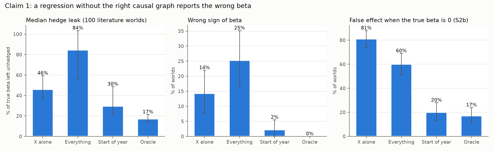

# Experiment 04: Causal Discovery for Portfolios

**Question.** A factor regression without a causal graph can report the wrong beta, and a hedge built on that beta leaks risk. How large is that error? And which way of drawing the graph gets the beta closest to the truth: an LLM reading the literature, a supervised model reading the data, or both combined?

- Full plan, rules and results: [`design.md`](design.md) (results in Section 12)
- Predictions, committed before any run: [`predictions.md`](predictions.md)
- Write-up: [`exposition/experiment04_summary.md`](../../exposition/experiment04_summary.md)

## The answer in short

All figures use the 100 worlds built from the literature graph, where the true beta is known.

- **Without the right graph, the beta is badly wrong.**
  - Controlling for everything measured by year-end leaves a median **84%** of the true beta unhedged and gets the sign wrong 25% of the time.
  - Regressing on X alone leaves **46%** unhedged.
  - Controlling for the true confounder leaves **17%**.
  - When the true effect is zero, regressing on X alone still finds a significant, meaningful beta **81%** of the time.
- **No discovery method recovers that beta.** The LLMs, the supervised model and the hybrid all leave **32–40%** unhedged. That is about twice the oracle, and no better than simply controlling for what is measured before X (30%).
  - Every method missed the same thing: leverage drives both book-to-market and returns.
- **The supervised model reads the graph best, but that doesn't fix the hedge.**
  - B1 gets 68–75% of roles right at every agreement level. Claude Opus 5.5 gets 50% *on the literature's own graph*.
  - Yet B1 and Claude leak the same 38%, because only the confounder role enters the regression.
  - The hybrid never beats B1 on its own.
- **On realistic data, the supervised model's lead mostly disappears.** With fat tails and a regime break, B1 falls 19 points. On the literature graph it lands level with Claude.

## Check a claim yourself

Result files are in [`results/exp04/b6_analysis/`](../../results/exp04/b6_analysis/). Scripts are in [`b6_analysis/`](b6_analysis/).

| #  | Claim                                                                                         | Figure                                                | Result file                                                                              | Script                                                    |
| -- | --------------------------------------------------------------------------------------------- | ----------------------------------------------------- | ---------------------------------------------------------------------------------------- | --------------------------------------------------------- |
| 1  | No graph → wrong beta → the hedge leaks risk                                                | [`fig1_beta_error.png`](figures/fig1_beta_error.png) | `scores_betas.csv` (subsets `lit`, `s2b`)                                          | `score.py`                                              |
| 2  | Which method finds the right roles, across the agreement dial, and what that does to the beta | [`fig2_dial.png`](figures/fig2_dial.png)             | `scores_roles.csv`, `scores_betas.csv` (`lit`, `main`)                           | `score.py`; why: `diagnose.py` → `diagnostics.txt` |
| 3  | Does it survive a hidden confounder (S1), no direct effect (S2, S2b) and realistic data (S3)? | [`fig3_stress.png`](figures/fig3_stress.png)         | `scores_roles.csv`, `scores_betas.csv` (`s1`, `s2`, `s2b`, `s3`, `s3 lit`) | `score.py`                                              |
| 4  | Does combining the LLM and data beat either alone?                                            | [`fig2_dial.png`](figures/fig2_dial.png) (pink)      | `scores_roles.csv` (`A3`, `A3_tau0.5`, `A3_tau0.9`), `diagnostics.txt` part 3  | `score.py`, `diagnose.py`                             |
| 5  | What each method costs                                                                        | —                                                    | `costs.csv`                                                                            | `costs.py`                                              |
| — | Every prediction vs. its result (10 of 18 held)                                               | —                                                    | `verdicts.csv`                                                                         | `score.py`                                              |

### Predictions vs. results

| Prediction                                                      | Verdict | Measured                                                  |
| --------------------------------------------------------------- | ------- | --------------------------------------------------------- |
| P1 "Everything": wrong sign ≥ 20%, leak ≥ 50%                 | ✅      | 25%, 84%                                                  |
| P1b "Start of year": leak ≤ 35%                                | ✅      | 30%                                                       |
| P2 "X alone": wrong sign ≥ 10%, leak ≥ 30%                    | ✅      | 14%, 46%                                                  |
| P3 Oracle: leak ≤ 25%                                          | ✅      | 17%                                                       |
| P3b S2b false effect: naive ≥ 50%, oracle ≤ 20%               | ✅      | X alone 81%, Everything 60%, Oracle 17%                   |
| P4 B1 flat, 65–78%, spread ≤ 6 pts                            | ❌      | 67.8–75.4%, spread 7.6                                   |
| P5 Claude ≥ 75% at 100%, ≤ 25% at 0%                          | ❌      | 50.0% at 100%                                             |
| P6 gpt-oss ≥ 10 pts below Claude at 100%                       | ✅      | 32.5% vs. 50.0%                                           |
| P7 Claude and B1 cross between 75% and 100%                     | ❌      | B1 above at every level                                   |
| P8 Refutation helps only where the literature is wrong (Claude) | ✅      | −0.1 at 100%, +4 to +13 below 75%                        |
| P8 Same, for gpt-oss                                            | ❌      | +13 pts even at 100%                                      |
| P9 PC 33–45%, below B1                                         | ❌      | 38–49%; below B1 everywhere                              |
| P10 Hybrid ≥ the better of LLM and B1 (Claude)                 | ❌      | 2–20 pts below B1                                        |
| P10 Same, for gpt-oss                                           | ❌      | below B1 at 4 of 5 levels                                 |
| P11 S1: every method's leak at least doubles                    | ❌      | ×1.0–1.2                                                |
| P12 S2: only refutation ever removes X → Y                     | ✅      | A2 removes it 10% of the time                             |
| P13 S3: B1 and PC fall, the oracle's leak rises                 | ✅      | B1 −19.3, PC −6.9 pts; oracle 17% → 30%                |
| P14 Cost: LLM minutes at $0; B1 ~23 h of training               | ✅      | 6.6 / 10.8 min per run; 22.6 h + ~12 min per 500 datasets |

[`design.md`](design.md) Section 12 explains each failure.

## Validation: the tools reproduce their papers

| Check                                            | Our result                                    | Published                       | Result file                                                                                                                       | Script                                                                                                    |
| ------------------------------------------------ | --------------------------------------------- | ------------------------------- | --------------------------------------------------------------------------------------------------------------------------------- | --------------------------------------------------------------------------------------------------------- |
| PC baseline on ADIA public test                  | 38.30%                                        | ~40% (5th-place report: 37.79%) | [`results/exp04/a1_reproduce_adia/pc_baseline_score.csv`](../../results/exp04/a1_reproduce_adia/pc_baseline_score.csv)           | [`a1_reproduce_adia/pc_baseline.py`](a1_reproduce_adia/pc_baseline.py)                                   |
| ADIA 3rd-place solution                          | 71.64%                                        | 74.06% (private test)           | [`results/exp04/a1_reproduce_adia/third_place_full_score.csv`](../../results/exp04/a1_reproduce_adia/third_place_full_score.csv) | [`a1_reproduce_adia/run_third_place.py`](a1_reproduce_adia/run_third_place.py)                           |
| LLM pipeline on Asia / Sprinkler                 | Claude 8/8 (memorized), gpt-oss 7/8 + 8 extra | —                              | [`responses/`](responses/), [`results/exp04/a2_reproduce_llm/refute/`](../../results/exp04/a2_reproduce_llm/refute/)            | [`a2_reproduce_llm/run_llm.py`](a2_reproduce_llm/run_llm.py), [`refute.py`](a2_reproduce_llm/refute.py) |
| My data generator vs. ADIA's (1,880 test graphs) | B1 71.99% on mine                             | 71.97% on ADIA's                | `results/exp04/b3_worlds/`                                                                                                      | [`b3_worlds/generator_check.py`](b3_worlds/generator_check.py)                                           |

## How to rerun

Run in order, in the `causal-factor` env, unless noted.

1. **Make the worlds.** `b3_worlds/make_datasets.py`
2. **Run every method.**
   - `a1_reproduce_adia/predict_third_place.py` (env `adia-3rd`)
   - `b5_runs/run_refute.py`
   - `b5_runs/run_pc.py`
   - `b5_runs/collect_roles.py`
   - `b5_runs/run_betas.py`
3. **Score.** `b6_analysis/score.py`, `costs.py` and `diagnose.py`

The LLM replies are already saved in [`responses/`](responses/), so rerunning never calls an LLM.

## Inputs

- The finance graph, with a source for every edge: [`graphs/finance_truth.json`](graphs/finance_truth.json)
- Exactly what the LLM sees: [`graphs/finance_variables.json`](graphs/finance_variables.json)
- Every LLM prompt and reply: [`responses/`](responses/)
- ADIA data: download it from the challenge, since it isn't redistributed here. It's expected under `data/adia/`.
